# Vault Claude

Chat with [Claude Code](https://claude.com/product/claude-code) or [Codex](https://developers.openai.com/codex) inside [Obsidian](https://obsidian.md). The plugin runs your installed command-line tools with your vault as their working folder, so they can read your notes and help you edit them.

Claude Code runs through the Claude Agent SDK and uses your existing CLI sign-in. You can use a Claude subscription without an API key. Codex uses your ChatGPT sign-in. Choose an engine for each new chat, or set one as the default for chats and other plugin features.

> [!NOTE]
> I built this plugin for my own use. Use it at your own risk.

Built by **Claude Opus 5** (`claude-opus-5`) and **Claude Opus 5.5** (`claude-opus-5-5`) in Claude Code.

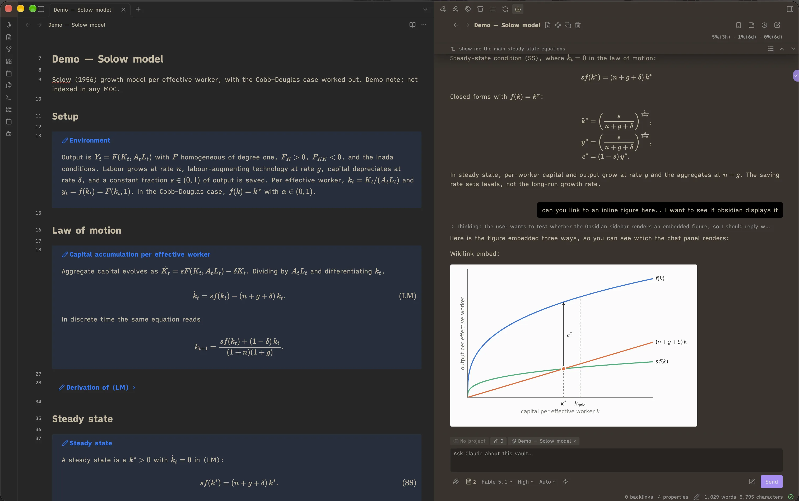

## Requirements

- **Obsidian desktop** on macOS or Windows. Enable the Bases core plugin if you want to use the Memos table.
- **Claude Code, Codex, or both**, installed and signed in. Only the engine you use needs to be installed.
- **Node.js 18 or later** if you build the plugin from source. Release downloads do not require a build.

### Claude Code

Use the [native installer](https://docs.claude.com/en/docs/claude-code/setup), then run `claude` in a terminal to sign in.

- macOS: `curl -fsSL https://claude.ai/install.sh | bash`
- Windows PowerShell: `irm https://claude.ai/install.ps1 | iex`

Windows also requires [Git for Windows](https://git-scm.com/downloads/win). The plugin needs the native `claude.exe`; it cannot start an npm-installed `claude.cmd`.

### Codex

Install the Codex CLI with `npm install -g @openai/codex` or `brew install codex`, or use the copy installed by the ChatGPT desktop app. Run `codex` in a terminal to sign in.

## Installation

The simplest installation is to download three files and copy them into your vault. No build is needed. Vault Claude is not yet listed in Obsidian's community plugin directory.

### Download three files

> [!TIP]
> **No build required.**
>
> 1. Download **main.js**, **manifest.json** and **styles.css** from the latest [release](https://github.com/manuelamador/obsidian-vault-claude/releases).
> 2. Move all three files into `<vault>/.obsidian/plugins/vault-claude/`. Create the folder if it does not exist.
> 3. In **Settings → Community plugins**, turn off Restricted mode if needed and enable **Vault Claude**.
> 4. Open the chat from the robot icon or **Vault Claude: Open chat**.

The `.obsidian` folder is hidden. In Finder, press ⌘⇧. to show it. In Windows File Explorer, enable **View → Show → Hidden items**.

To update a manual installation, replace the three files and disable and re-enable the plugin.

### With BRAT

[BRAT](https://github.com/TfTHacker/obsidian42-brat) installs plugins from GitHub releases and can keep them updated.

1. In **Settings → Community plugins**, turn off Restricted mode if needed. Choose **Browse**, find **BRAT**, and install and enable it.
2. Run **BRAT: Add a beta plugin for testing**.
3. Enter `manuelamador/obsidian-vault-claude` and choose **Add Plugin**.
4. Enable **Vault Claude** in **Settings → Community plugins** if BRAT has not already enabled it.
5. Click the robot icon in the left ribbon, or run **Vault Claude: Open chat**.

BRAT installs `main.js`, `manifest.json` and `styles.css` in `<vault>/.obsidian/plugins/vault-claude/`. Enable startup updates in BRAT's settings, or run **BRAT: Check for updates to all beta plugins and UPDATE**. Disable and re-enable Vault Claude after an update to load the new version.

### From source

Run these commands from the repository folder. Replace the example vault path with your own.

macOS:

```bash
npm install
npm run build
vault_path="/path/to/your/vault"
mkdir -p "$vault_path/.obsidian/plugins/vault-claude"
cp main.js manifest.json styles.css "$vault_path/.obsidian/plugins/vault-claude/"
```

Windows PowerShell:

```powershell
npm install
npm run build
$vaultPath = "C:\path\to\your\vault"
New-Item -ItemType Directory -Force "$vaultPath\.obsidian\plugins\vault-claude"
Copy-Item main.js, manifest.json, styles.css "$vaultPath\.obsidian\plugins\vault-claude\"
```

Then enable and open the plugin as described above.

### Executable paths

The plugin looks for Claude Code in `~/.local/bin`, Homebrew's folders and PATH. On Windows, it also checks `%USERPROFILE%\.local\bin\claude.exe`.

For Codex, it checks PATH, Homebrew's folders and the ChatGPT app's installation at `~/.codex/plugins/.plugin-appserver/codex-cli/bin`.

If detection fails, set **Claude Code executable** or **Codex executable** under **Settings → Vault Claude**.

## Features

### Chatting

- **Read replies in Obsidian Markdown.** Wikilinks, callouts, equations and vault images render in the panel. Thinking, tool calls and intermediate notes collapse into a **Steps** line.
- **Review file changes.** Replies list changed files and their diffs. Open a file at the affected line.
- **Work with a reply.** Quote a passage, ask a side question, copy it, insert it into a note, save it as a memo, or branch into another chat.

<details>
<summary><strong>Reply tools and navigation</strong></summary>

- Click a changed-file card to expand its diff. Click its name to open the file, or a diff line to jump to that line.

  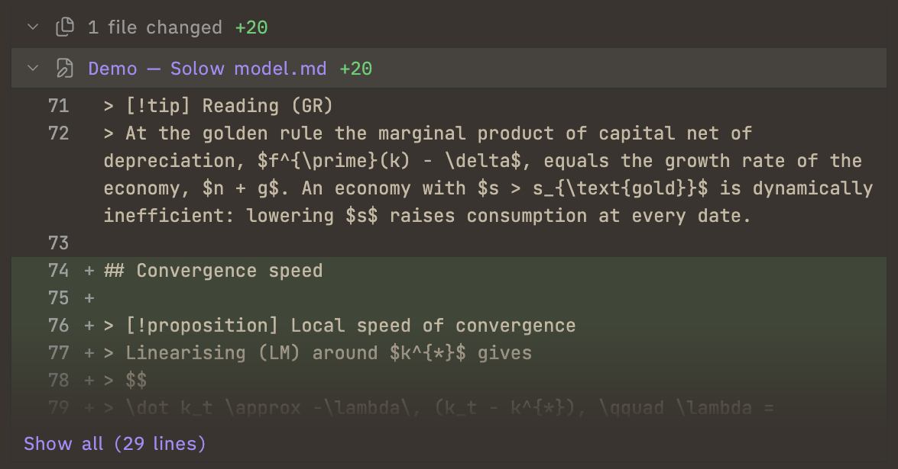

- File names written in bold or code with an extension, such as `Notes.md`, open the file. Wikilinks open their notes. Hold ⌘ while hovering to preview a link.
- Select text to reveal **Quote**, **Side chat** and **Memo**. Selected equations are quoted as LaTeX.

  

- Open a side chat from a selection or the chat title. It can use the conversation so far, and accepts pasted or dropped images. Claude side chats run in Plan mode; Codex side chats are read-only copies. **Minimise** leaves a bar at the bottom so you can return to the main chat. Claude side chats can be kept with **Keep as a chat**; otherwise they are deleted when closed.

  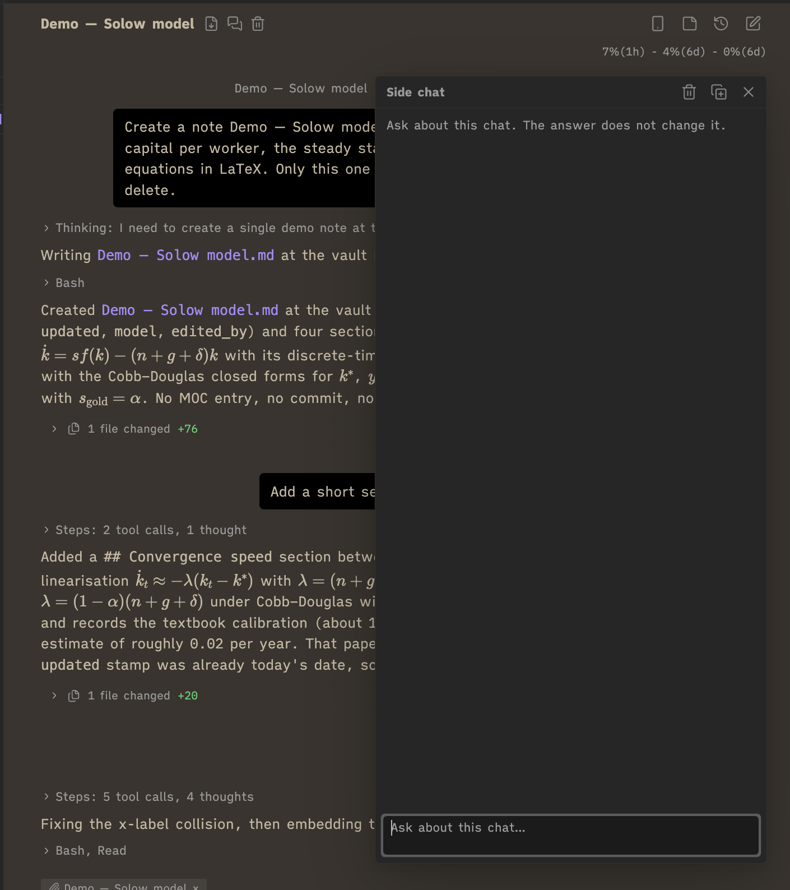

- Buttons under each reply let you reply to it, copy it, insert it into a note, save a memo, or branch from that point.

  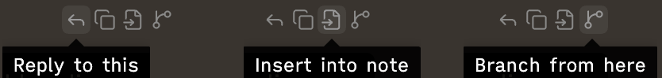

- Checkbox ticks are saved across chat reopening and Obsidian restarts. They are your own marks; the assistant sees them only if you send them in a message. Copying or saving a reply includes its current ticks. Later ticks do not update the saved note.

  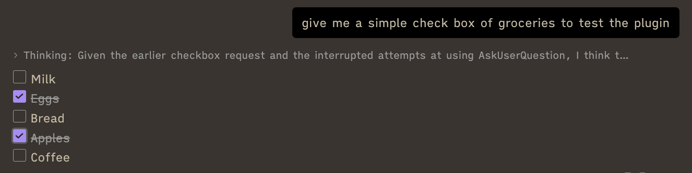

- The bar above the chat identifies the prompt being answered. Use its arrows or ⌥↑/⌥↓ to move between prompts, its list to see them all, or ⌘F to search.

  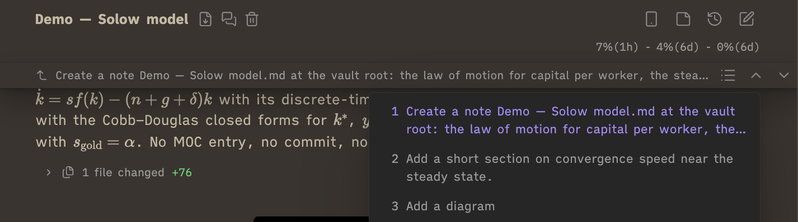

- Long chats initially show their latest exchanges, up to ten exchanges and roughly 250 messages. Scroll up to load earlier ones. For the two most recently read long Claude chats, the plugin can read only newly appended content when their files have not been rewritten.
- Messages sent while Claude is working are queued. Click **send now** on a queued message to deliver it at the next pause.
- The pencil beside Send opens a draft note for your message. Send it from the line above the input, or discard it with ×.

  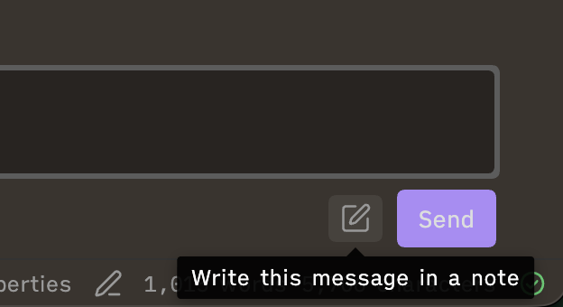

</details>

<details>
<summary><strong>Adjusting equation size</strong></summary>

If equations look too small, add a CSS snippet under **Settings → Appearance → CSS snippets**. This example increases the usual MathJax size by 5%; adjust it to suit your theme:

```css
mjx-container.MathJax { font-size: calc(113.1% * 1.05) !important; }
```

</details>

### Working with notes

- **Add context.** Attach the open note, include selected text, or mention notes, files and folders with `@`. Use the paperclip, paste, or drag and drop to add files and images.
- **Suggest frontmatter updates.** Review proposed property changes based on a note, nearby notes and related chats. Edit the values and apply only the ones you select. Folder-specific guidance is remembered.
- **Edit a selection.** Right-click selected note text to ask a question or request an edit. Review the word diff before accepting.

  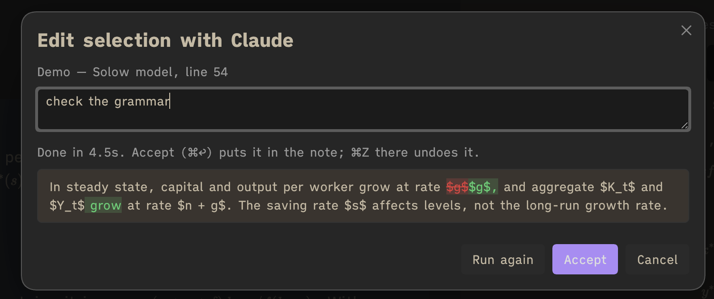

- **Send a note as a prompt.** A note's file menu can attach it or use its contents as your next message.

<details>
<summary><strong>Attachments, mentions and note menus</strong></summary>

- Use **+** on the attached-note chip to attach the open note, or **×** to detach it. Attached notes are sent by path; selected lines are included as text.
- Type `@` to find a note, file, folder, chat or Zotero item. The picker has **Files**, **Chats** and **Zotero** tabs; press Tab to switch. Search chats by title and Zotero items by title, author or year. Files excluded in **Settings → Files and links → Excluded files** do not appear.
- Mentioned notes include their text and an approximate token count. Click a note's chip to send only its path; click again to include its text. Other files and folders are sent by path. Hover over a chip to see what will be included, or click an image chip to view it at full size.
- **Zotero in @** is off by default. When enabled and Zotero is running, the picker lists My Library and group-library items. A selected item includes its citation, DOI, Zotero link and local PDF path in either engine's chat. The plugin reads this information through Zotero's local API; it reports when Zotero is unavailable.

  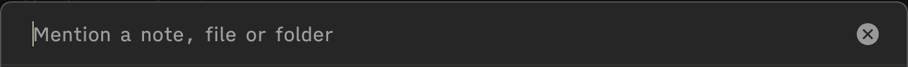

- Right-click selected text for **Ask Claude about selection** or **Edit with Claude**.

  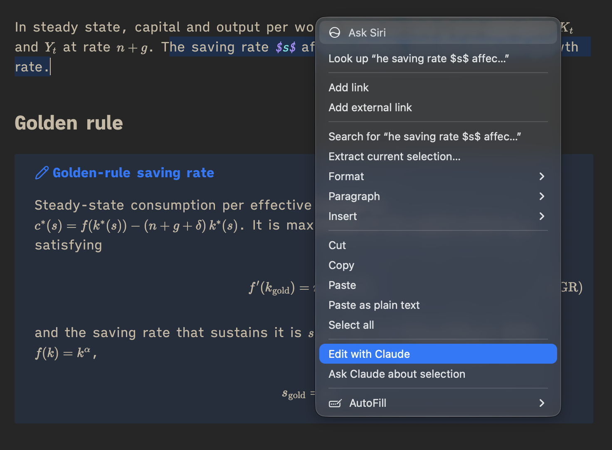

- Right-click a file in the explorer, or open a note's ⋯ menu, for **Attach to Claude**. Notes also offer **Send to Claude as a prompt**. Selection and note actions are also available in the command palette.

  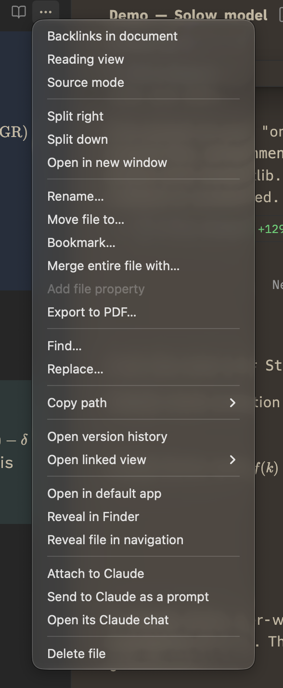

</details>

### Email cards and drafts

Gmail results appear as message and draft cards in Claude and Codex chats. Open them in Gmail, quote a message, save it as a note, or make a todo. Cards do not send or edit mail; ask the assistant in the chat to do that.

<details>
<summary><strong>Using email cards and drafts</strong></summary>

**Message cards** show the sender, To, Cc, Bcc when available, subject, date and message text. Unread messages are marked. Read a full message or thread to see its body and available attachment details.

Attachment chips open files in Gmail when a link is available. Images are grouped into a count. **Download all**, when available, opens Gmail's attachment zip download. The plugin does not fetch email or attachments itself; cards display the connector's results.

Use a card to open Gmail, quote the message, start a chat about it, make a todo, or save a note. A thread can be saved as a single note. **Make a todo** uses `Todo.md`, under **Open**, by default; both are configurable, and a due date is optional.

**Draft an email from this note…** opens a chat with the note mentioned and a request for a draft. Tell the assistant whom to write to and what to say. Draft cards show recipients, subject, text and attachments when available. Ask in the chat to change or send a draft; the engine and connector handle permissions. Later successful tool calls mark cards **Sent**, **Deleted** or **Earlier version**.

Email content is treated as data. Card links are restricted to Gmail, and saved or quoted messages escape images and HTML. These display protections do not replace the engine's permission controls.

The plugin remembers which threads each chat read. Above the input, a line lists threads read by chats associated with the open note. Connections lists a chat's threads below its map.

</details>

### Memos

**Keep useful passages as notes linked to their source.** Save a selection or reply as a memo, with a title, description and tags, or make a quick bookmark. Memos are ordinary notes, stored by default in `Claude chats/Memos/` beside `Memos.base`. The Memos table lets you browse by chat, note or tag and return to the original conversation.

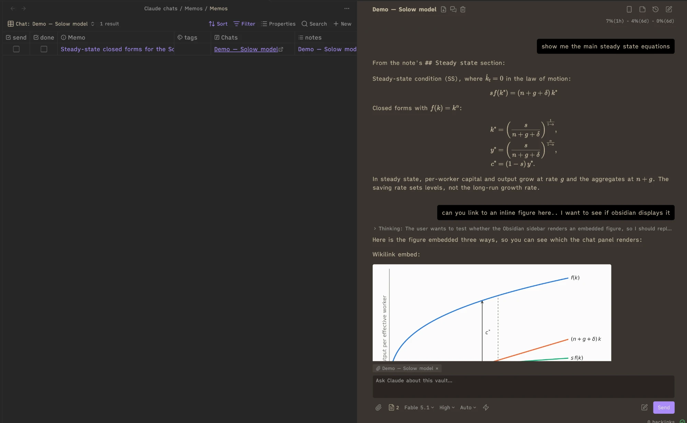

<details>
<summary><strong>Saving and using memos</strong></summary>

- Choose **Memo** above selected chat text, or the sticky-note button under a reply. A selection spanning several messages keeps separate passages labelled You or Claude. A reply memo includes its prompt. Equations remain LaTeX.
- The model configured for small jobs suggests a title and description. Edit them, add tags, and optionally explain **Why I'm keeping this**. Each save creates a new memo.
- **Related memos and notes** includes the attached note and notes linked from the selected passages. Remove any you do not want. **Link a memo or note…** lets you add others; archived memos remain available and are labelled.

  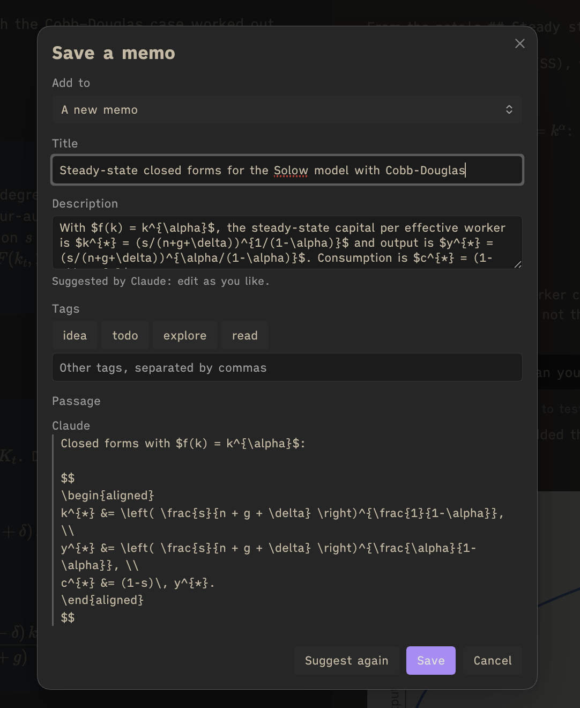

- For a bookmark, leave the title empty or ⌥-click (Alt-click) **Memo** to skip the form. The opening words become the title, a timestamp is added if needed, and the memo receives the `bookmark` tag.
- A memo contains its description, **Why**, **Next** and **Sources**. Fill in Next yourself. Sources records each passage's author and date, with links back to the chat. Properties link related notes and memos.
- **Continue from this memo**, in the command palette or note menu, prepares a new chat. Choose which passages, Why and Next sections, related notes, and linked memos to include. Nothing is sent until you send the prepared message.
- **Go to the passage** opens the source message, loading earlier exchanges or searching its text if necessary. **Continue in the chat** opens that chat with the passage quoted.
- The top sticky-note button opens all memos. ⌘-click opens only the current chat's memos. The notes menu beside the paperclip also lists them.

  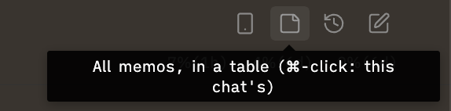

- The table has views by chat, note and tag. When left open, it follows the panel's current chat. **Send to chat** adds a memo to the input; clearing the input removes the mention. Use **Status** for your own labels, such as exploring or resolved. **Archived** moves a memo to the Archived view. The Chats column opens source chats at their passages.
- Delete memos like other notes, or select their table rows and choose **Delete**.

</details>

### Controls and approvals

- **Choose the model and permissions.** Set the model, reasoning effort, permission mode and fast mode below the input. Defaults and deny rules are in settings. Claude and Codex apply permissions differently; see the Codex section below.
- **Review plans before execution.** In a Claude chat, choose Plan mode or type `/plan`. Approve the plan, edit it in a note, reject it, or tell Claude what to change.

  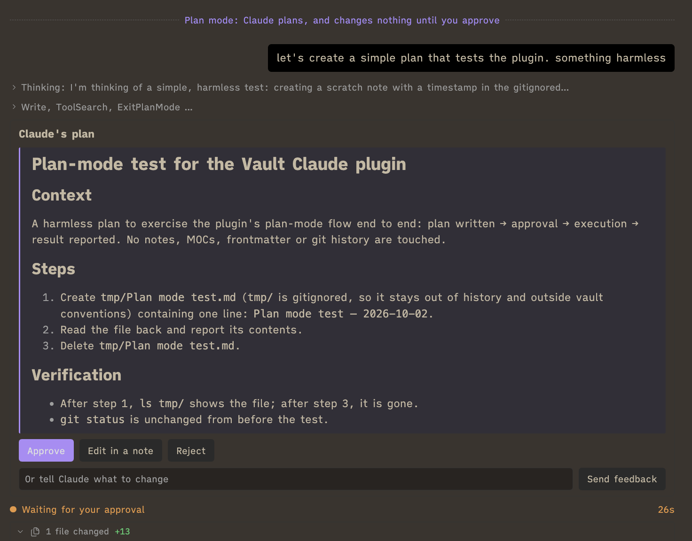

- **Answer questions in the panel.** Question cards accept choices and written answers.
- **Receive notifications.** While Obsidian is in the background, notifications report long replies finishing and requests for approval or input.
- **Track usage.** Hover over the meter for context use, account limits and reset times. **Compact now** asks the engine to compact the conversation. Reopened chats show their last saved context reading until fresh usage arrives.

<details>
<summary><strong>Controls, plans, questions and usage</strong></summary>

The controls below the input select the model, effort, permission mode and fast mode.


- **Leave plan mode** exits without approving the plan.
- **Edit in a note** opens a temporary plan note. Approval sends your revised version and removes the temporary note. If Esc withdraws the plan, your edits are retained for Claude's next plan in that chat.
- **Skip** declines a question.

  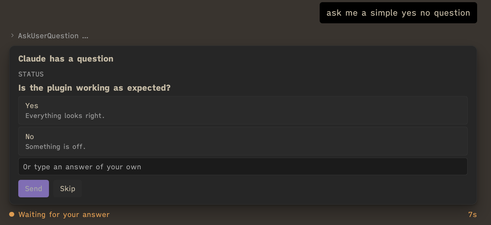

- Hover over the usage meter for token counts, account usage and reset times. A divider marks compaction.

  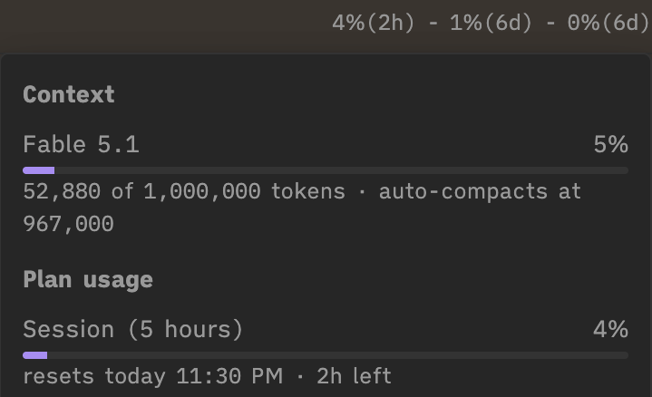

- Default deny rules cover `git checkout`, `git reset`, `git restore`, `git clean` and `rm -rf`. Claude applies its deny rules across permission modes. In Codex, the plugin checks commands only when Codex asks it for approval.

</details>

### Managing chats

- **Find earlier work.** Search history by title, prompt, reply or note. Pin, rename or delete chats from the list.

  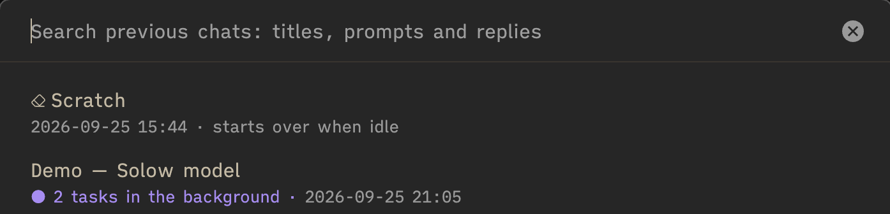

- **Return to recent work.** An empty chat lists recent conversations, with pinned chats first. **Pick up where you left off** suggests recent and older conversations that may be worth continuing.
- **Delegate a task.** Right-click **Send**, or run **Run this message in a new chat, report back**. Your message runs in a linked background chat using the current engine, model and attached note. A report appears here when it finishes; you decide whether to add it to your message, open the chat or dismiss it.
- **Keep several chats running.** Switching chats preserves their drafts and attached notes. A tab on the panel's right edge marks a background reply that finished or failed. Open separate chat tabs or branch from an earlier reply.
- **Use a scratch chat.** Keep a standing conversation for quick questions. It starts over after 24 hours unused by default; useful exchanges can be copied into ordinary chats.
- **Save a conversation.** Buttons beside the title save the chat or a summary as a note, or delete the chat.

<details>
<summary><strong>Pick up where you left off</strong></summary>

Open this feature from the command palette, an empty chat, or the New chat button's right-click menu. The configured small-job model reviews short excerpts from recent chats and a random selection of older, potentially unfinished chats. Suggestions are kept for the day; **Suggest again** refreshes them.

Select a suggestion to see a possible next step, related notes and memos, the reasons it was suggested, and recent exchanges. Links open their notes; ⌘-hover previews them. **Use suggested step** opens the chat and appends the step to any existing draft. **Open chat** leaves the draft alone.

Each suggestion has controls to remind you on up to five days, skip it for a week, or ignore it indefinitely. Click a reminder's clock to stop it. **Clear ignored chats** makes ignored chats eligible again.

The plugin reads chats and memos locally. It sends short excerpts to the selected model when generating suggestions, without adding a message to any source chat.

</details>

<details>
<summary><strong>History, branches and background tasks</strong></summary>

- The clock opens history. A blue phone icon marks a chat available on the phone. **✕** closes a background chat's process while keeping its conversation, or takes a foreground chat off the phone. The plugin asks first if closing would interrupt work or a pending approval. ⌘↵ or ⌘-click opens a history item in a new tab.

  

- Press **Tab** in history to browse by note. Search by note name or folder, then add words to filter chat titles, for example `with:solow diagram`. ⌘↵ opens the note.
- A grey ○ means open or idle in the background. An accent ● marks activity, pending input, background tasks or an unseen reply. No mark means the chat is closed.
- History is reconstructed from Claude session files and recorded Codex threads. **Rebuild chat list from sessions** restores missing records and refreshes titles that still match an initial prompt. It also runs automatically after an update. Chat records, settings and their backups are described under **Your data**.
- **History includes all vault sessions** also lists Claude sessions started in a terminal or desktop app. They appear in italics. Continuing one creates a copy so two programs do not write the same session. History groups the copies and offers the most recent one. Codex history lists chats started by the panel.
- The New chat button starts a chat; ⌘-click creates a new tab. Hover over a panel tab's icon to see its chat title.

  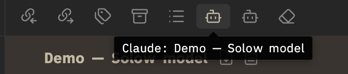

- Background replies leave ✓ or ! tabs on the panel's right edge, newest first. Hover to see the title and reply preview, click to open, or use × to dismiss. Extra tabs are grouped under **+N**. Unopened tabs survive an Obsidian restart. If the panel is hidden, a notice also reports completion.

   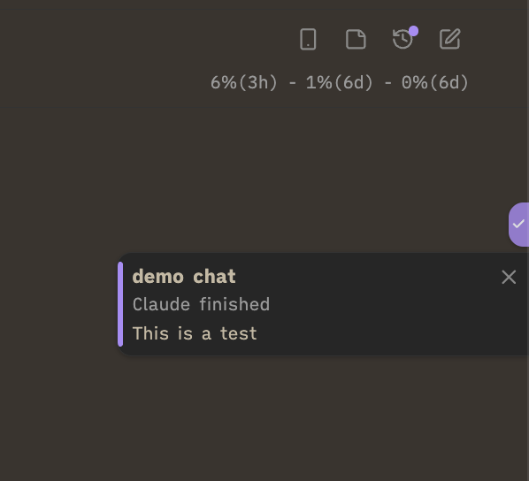

- Agents and commands can continue after a reply finishes. **Stop N tasks** beside Send, or ■ in history, stops them. Stop/Esc asks before ending active tasks. **Show background tasks** lists progress, elapsed time and command output, with a Stop button for each task. The last 20 finished tasks remain until **Clear** or an Obsidian restart.

  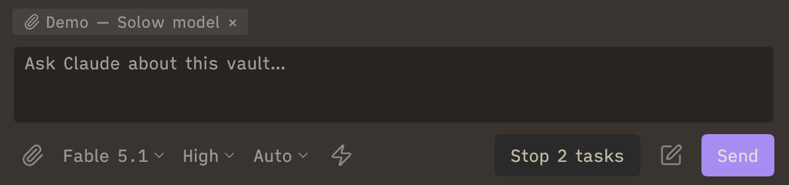

- With a note open, the line above the input lists chats that changed or received it. ⌥-click removes an association. Search with `with:` in history to find chats about other notes.

  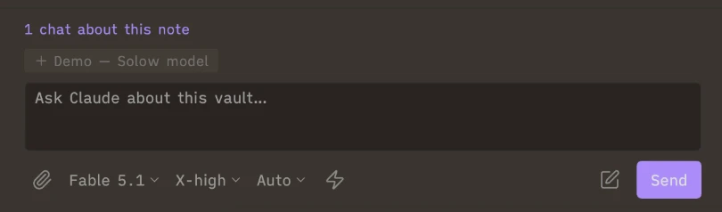

- The document button beside the paperclip lists memos and notes changed or mentioned in the chat. Click to open a note or ⌥-click to attach it. **This chat's memos in a table** opens the Memos table for that chat.

  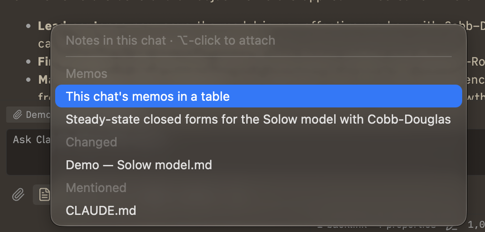

- Scratch appears first in history. Change its timeout in settings or clear it with its trash button. **Continue as a chat** copies the conversation through a selected reply. **Continue in a chat about "…"** lets you choose a starting prompt for work on a note, copies that work to an ordinary chat, and prepares a message about the note. The scratch chat retains a link to the copy. **Keep scratch chat** copies the whole conversation.
- **Move chat to the main area, or back to the sidebar** switches between the sidebar and a full-width tab. **Open chat in a new window** gives it a separate window. Running chats keep working. Notes opened from the panel go to the main window. Closing the only chat tab outside the sidebar transfers its work to a new sidebar panel.
- The arrow beside your message offers **Copy from here on to a new chat**, **Move from here on to a new chat**, **Send this message to another chat…** and **Remove from here on**. Claude moves and removals offer Undo for ten seconds. Undoing a move also deletes its new chat unless you have continued it. These actions change conversations, not files the assistant edited. Codex has different removal limits, described below.

  

</details>

### Connections, projects and linked chats

**See how a conversation connects to your work.** Connections maps the current chat, its notes grouped by folder, and other chats linked to it or sharing those notes. The map follows the panel as you switch chats.

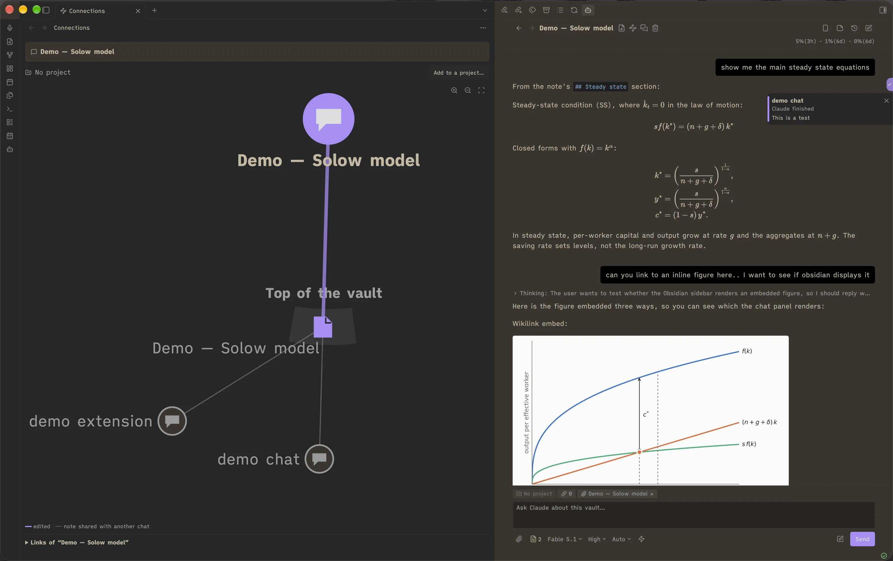

<details>
<summary><strong>Using Connections and projects</strong></summary>

- Run **Open connections**, or use the project and links chips above the input. Connections opens as a tab beside your notes. Codex chats carry a **Codex** label.
- Click a chat to open it in the panel. Click its project to view the project map. Use ← and → to navigate between maps. Chats started outside the panel are initially shown without editing controls.
- Right-click a note on the map, or open a project's menu, for **Open local graph**. It opens the note and Obsidian's local graph. The Graph view core plugin must be enabled.
- A **project** is a note associated with a folder. Chats join projects through the notes they use, or through **Put in**, **Move…**, **Take out** and **Add to a project…**. Project context accompanies chat messages and is sent again after Claude Code compacts the chat.
- **Create project…** creates a project. **Write every project's context anew** asks before regenerating all project contexts.
- **Link a chat…** links two chats for navigation. Linking alone sends no content. Tick **Include** to send a short digest of the linked chat with your next message. **Summarise first** generates a summary from more of its conversation.
- **Rebuild connections from chat files** reads saved conversations and adds their links to notes changed, included or mentioned. It does not remove existing links. Run it from the command palette, the Connections ⋯ menu or settings.

</details>

### Codex

Choose **New Codex chat** from the command palette or the New chat button's right-click menu. You can also select **Claude Code | Codex** on an empty chat before sending its first message. **New chats run on** sets the default engine.

Codex chats are labelled beside their titles, in history and in Connections. They use Codex's app-server and `~/.codex/config.toml`, with the model, effort and permissions selected in the panel.

<details>
<summary><strong>Codex features and differences</strong></summary>

- Replies, reasoning summaries, commands, changed files and diffs use the same panel as Claude chats. The model menu lists available Codex models and their supported reasoning efforts. The meter shows Codex context use and account limits.
- The permission menu applies from the next message: **Read only**, **Ask first**, **Default**, **Auto (reviewer)**, or **Full access** when bypass options are enabled. Default allows vault edits and asks for access outside the vault or online. Auto uses a Codex reviewer for those approvals. Full access permits actions without asking.
- Commands and file changes that require approval appear as cards. Plugin deny rules check commands sent to the panel for approval; they do not check commands Codex approves automatically or through its reviewer.
- Model, effort and permissions are saved for each Codex chat. Claude chats likewise remember their model, effort and permission mode, except Plan mode.
- Project context and included chats work with both engines. Codex side chats use temporary read-only copies and cannot be kept as ordinary chats.
- **Small jobs run on** selects the engine for selection edits, summaries, memo suggestions, frontmatter suggestions, project context and **Pick up where you left off**. **Scratch chat model** selects the scratch engine and model. Set all three engine choices to Codex to use the plugin without Claude Code.
- Removing a Codex chat from panel history leaves its conversation in Codex's own store. An expired or cleared Codex scratch chat is archived there.
- Branching copies the conversation from its beginning through the selected reply's turn, or copies the whole chat. The copy retains the model, effort and permissions.
- Codex supports **Send this message to another chat…** and **Remove from here on**. Removal has no Undo. It cannot copy or move only the exchanges after a selected message into another chat.
- **Compact now** requests compaction and adds a divider when it occurs. **Fast mode** (⚡) requests the fast tier for supported models and uses more of your Codex limits.
- Chats appear in Codex's own app and phone lists under their panel titles. Context added by the panel is sent separately, so your messages remain readable as typed. Messages from before 0.35.0 retain the older combined format.
- Without phone access, an idle Codex process is released after three minutes. See **Phone access** for shared sessions and app ownership limits.
- Claude Code's Plan mode, `/plan` and slash commands are unavailable in Codex chats.

</details>

### Phone access

The phone button controls Claude Code and Codex separately. Its settings are remembered across Obsidian restarts.

- **Claude Code on the phone** makes the current Claude chat and background Claude chats available through the Claude app or claude.ai/code. New chats follow the same setting. You can also start new vault sessions from the phone.
- **Codex on the phone** routes chats through Codex's shared app-server with remote control enabled. The plugin starts the server when needed and stops a server it owns when Obsidian quits. A server started elsewhere is left running.

The button uses the accent colour for Claude, green for Codex, and an accent colour with a green dot when both are enabled.

Codex permits only one process to write a chat at a time. If the ChatGPT desktop app holds a chat, close that chat or quit the app before continuing it in Obsidian. The panel follows conversation updates and preserves an unsent message when ownership prevents a send. A running daemon does not guarantee that another app will release the chat.

### Safety

- Replies load images only from vault files. Other images and embedded notes become links. Most raw HTML is shown as text; a small set of formatting tags, including `<br>` and `<sup>`, is allowed. Rendered content is checked against an allowlist of local resources, including content added after rendering.
- Email cards display text without executing HTML. Saved and quoted email content escapes active image and HTML syntax. Gmail links are restricted to `https://mail.google.com/`. These protections do not prevent an email's words from influencing an assistant; email content is explicitly described to it as data.
- Sending and editing mail use the engine's permission flow. Display cards do not authorize those actions. Connector confirmations forwarded to the panel appear as approval cards.
- Bypass mode must be enabled in settings and is not used for Claude phone sessions. Review the Codex permission differences above before choosing Full access.
- Closing a panel transfers its running chats to another panel when possible. Otherwise they stop, and pending questions, plans and approvals are declined. Closing the only main-area or pop-out panel can create a sidebar panel to keep its work running. Quitting Obsidian ends every chat process the panel started (Claude and Codex, including background and side chats), the phone server, and the Codex server it started.
- Conversations are saved as they run and can be reopened from history.

## Keyboard shortcuts

| Keys | Action in the panel |
| --- | --- |
| ⌘↩ / Ctrl+Enter | Send; Enter sends instead if this setting is off |
| ↑ in an empty input | Recall sent messages, starting with this chat and then other chats; ↓ moves forward, Esc clears |
| Esc | Stop the reply, or close a side chat; task shutdown may require confirmation |
| ⌥↑ / ⌥↓ | Previous / next prompt |
| ⌘[ / ⌘] (Windows: Alt+← / Alt+→) | Back / forward through visited chats |
| ⌘F | Find; ↩ and ⇧↩ move between matches, Esc closes |
| ⌘-click New chat | Open a new chat tab |
| ⌘-click / ⌥-click a note in the notes menu | Open in a new tab / attach as an `@` mention |
| ⌘-hover a link or file name | Preview the note |
| ⌘-click a diff line | Open the note at that line in a new tab |
| ⌥-click Memo or a reply's sticky-note button | Save a bookmark without opening the form |
| ⌘-click the top sticky-note button | Open this chat's memos |

On Windows, use Ctrl for ⌘ and Alt for ⌥ unless a different shortcut is listed.

## Your data

- **Claude conversations** are stored outside the vault in Claude Code's session files under `~/.claude/projects/`. Deleting a Claude chat from history deletes its session file.
- **Codex conversations** remain in Codex's store under `~/.codex/`. The plugin reads them through the app-server. Removing a chat from panel history does not delete its Codex conversation.
- **Chat records** are stored in `<vault>/.obsidian/plugins/vault-claude/chats.json`. They include titles, engine choices, pins, drafts, attached notes, links, projects, summaries, checkbox ticks and other chat-related state.
- **Settings and input history** are stored in `data.json` in the same folder. Input history keeps up to 100 sent messages of up to 1,000 characters each. Deleting a chat does not clear that history. Turn off **Remember sent messages for ↑**, or use its **Clear** button, to control it.
- Both data files use temporary-file replacement and a backup. The plugin also keeps daily copies for the last seven days in its `backups/` folder. Obsidian Sync may sync these files with plugin settings.
- The **diagnostic log** contains process activity, errors, session IDs and paths. It does not deliberately log conversations, but errors can contain command text or process output. Read it before sharing it. Locations: `~/Library/Logs/vault-claude.log` on macOS, `%LOCALAPPDATA%\vault-claude\vault-claude.log` on Windows, and `~/.local/state/vault-claude/vault-claude.log` on Linux.

Messages and context are sent through Claude Code or Codex. If Zotero integration is enabled, the plugin also reads Zotero's local API on your computer. It does not contact Gmail directly.

## Settings

| Setting | Purpose |
| --- | --- |
| New chats run on | Default chat engine: Claude Code or Codex |
| Small jobs run on | Engine for selection edits, summaries, memo and frontmatter suggestions, project context and chat suggestions |
| **Claude Code** | |
| Claude Code executable | Path to `claude`; detected when empty |
| Default model, effort | Starting model and effort for Claude chats; use the engine's default or its configured model |
| Model for small jobs | Claude model for helper features; default Sonnet |
| **Codex** | |
| Codex executable | Path to `codex`; detected when empty |
| Default Codex model, effort | Starting values; empty uses Codex's defaults |
| Default Codex permissions | Starting permission level; default Default |
| Codex model for small jobs | Helper model; defaults to the chat model |
| **Chats** | |
| Attach the open note to new chats | Attach automatically; off by default |
| Files left out of a chat's notes | Exclusion patterns; default `*attachments/*` |
| Side chat knows | Whole conversation or only the question; default whole conversation |
| Remember sent messages for ↑ | Keep input history; enabled by default, with Clear to erase it |
| History includes all vault sessions | Include Claude sessions started outside the panel |
| Rebuild connections | Recover chat-to-note links from saved conversations |
| Notify when Claude finishes, Notify after | Enable notifications and set the duration threshold; defaults on and 30 seconds |
| **Scratch chat** | |
| Scratch chat | Enable the standing scratch conversation; on by default |
| Scratch chat starts over after | Idle timeout from one hour to one week; default 24 hours |
| Scratch chat model | Engine and model; defaults to the small-job choice |
| **Permissions** | |
| Default permissions | Starting permission mode for Claude chats (Claude Code section) |
| Offer bypass permissions | Show Claude Bypass and Codex Full access options |
| Deny rules | Claude tool restrictions; in Codex, restrictions on commands sent to the panel for approval |
| **Zotero** | |
| Zotero in @ | Include local Zotero libraries in the picker; off by default |
| **Gmail** | |
| Gmail features | Enable message/draft cards, email todos, note-to-draft requests and thread lists; on by default |
| Todo note | Destination note and section; defaults `Todo.md` and Open |
| **Saved notes** | |
| Folder for saved chats | Destination for saved chats and summaries; default `Claude chats` |
| Folder for memos | Destination for memos and their table; default `Claude chats/Memos` |
| **Appearance and input** | |
| Tool calls | Show a summary, individual lines, or hide them |
| Panel side margins | Horizontal margins from 8 to 96 px |
| Send with ⌘+Enter (Ctrl+Enter on Windows) | Use the modifier shortcut instead of Enter |
| **Phone access** | |
| Claude Code on the phone | Enable Remote Control for Claude chats and new vault sessions; off by default |
| Name in the Claude app | Vault name shown in the Claude app |
| Codex on the phone | Use Codex's shared app-server; off by default |
| Keep Codex chats out of Codex's own lists | Archive chats while not open in the panel; off by default |
| **Advanced** | |
| Extra PATH entries | Additional directories for commands run by the engine |

## Commands

Use Obsidian's command palette and search for **Vault Claude**. Commands include:

- **Chats:** Open chat; New chat; New chat in a new tab; New Codex chat; Chat history; Rename chat; Branch this chat into a new tab; Save chat as note; Save chat summary as note; Run this message in a new chat, report back.
- **Navigation:** Find in chat; Go to previous / next message you sent; List messages you sent; Focus chat input; Move chat to the main area, or back to the sidebar; Open chat in a new window.
- **Notes and messages:** Ask Claude about selection; Edit selection with Claude; Send this note to Claude as a prompt; Suggest frontmatter updates for this note; Draft an email from this note…; Quote the selected chat text in your next message; Write this message in a note; Send the draft note.
- **Memos and projects:** Continue from this memo; Open connections; Create project…; Write every project's context anew; Rebuild connections from chat files.
- **Scratch and suggestions:** Open scratch chat; Clear scratch chat; Pick up where you left off; Pick up where you left off: show ignored chats again.
- **Runtime and recovery:** Open side chat; Stop Claude; Show background tasks; Toggle fast mode; Toggle Claude Code on the phone; Toggle Codex on the phone; Rebuild chat list from sessions.

## Limitations

- Claude chats use separate local processes. Codex chats use individual processes or a shared app-server, depending on phone access. Keeping many chats active can use substantial memory.
- Codex cannot copy or move a conversation starting from a selected message, and removing Codex turns has no Undo.
- Background tasks end when Obsidian quits or when their last owning panel closes without a handoff.
- Claude chats enabled for phone access appear as separate sessions in the Claude app.
- Tested on macOS. Windows support is implemented but has not been tested on a Windows machine; Linux is untested.

## Troubleshooting

- **Blank panel after an update:** close the panel tab and reopen it from the ribbon.
- **Codex not found:** install and sign in to the CLI, or set **Codex executable** in plugin settings.
- **Claude Code executable not found:** use the native installer, or set **Claude Code executable** in plugin settings.
- **Claude Code / SDK version notice:** update Claude Code with `claude update`, or update the plugin if Claude Code is newer than its bundled SDK expects.
- **Windows npm installation:** replace `claude.cmd` with the native installation that provides `claude.exe`.
- **Failed to authenticate:** for Claude, run `claude` in a terminal and use `/login`. For Codex, run `codex` and sign in. Retry after signing in.
- **Codex chat held by another app:** close the chat in the ChatGPT desktop app, or quit that app, then try again. Your unsent message stays in the panel.
- **Other errors:** include the diagnostic log in a bug report after checking it for private paths and error details.

## Alternatives

Other Obsidian chat plugins include [Claudian](https://github.com/YishenTu/claudian), [Copilot for Obsidian](https://github.com/logancyang/obsidian-copilot) and [Agent Client](https://github.com/RAIT-09/obsidian-agent-client).

## License

[MIT](LICENSE). The renderer workarounds in `esbuild.config.mjs`, `src/electronCompat.ts` and `src/session.ts` follow [Claudian](https://github.com/YishenTu/claudian) (MIT).
