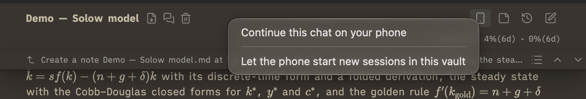

# Vault Claude

An [Obsidian](https://obsidian.md) sidebar chat that runs your locally installed Claude Code in the vault, through the Claude Agent SDK. It uses the same sign-in as the `claude` CLI, so a Claude subscription works without an API key. It can also run [Codex](https://developers.openai.com/codex), with your ChatGPT sign-in, in the same panel: chat by chat, or for everything.

> [!NOTE]
> This plugin was built for my own personal use. Use it at your own risk.

Built by **Claude Opus 5** (`claude-opus-5`) and **Claude Opus 5.5** (`claude-opus-5-5`) in Claude Code.


## Requirements

- Obsidian desktop on macOS or Windows, with the Bases core plugin on for the Memos table.
- At least one of Claude Code or Codex.
- Claude Code, installed with the [native installer](https://docs.claude.com/en/docs/claude-code/setup) and signed in (run `claude` once in a terminal and log in):
  - macOS: `curl -fsSL https://claude.ai/install.sh | bash`
  - Windows (PowerShell): `irm https://claude.ai/install.ps1 | iex`. Claude Code on Windows also needs [Git for Windows](https://git-scm.com/downloads/win). An npm install of Claude Code (`claude.cmd`) does not work with the plugin on Windows.
- Codex: the Codex CLI, signed in. The ChatGPT desktop app installs it; so do `npm install -g @openai/codex` and `brew install codex`. Run `codex` once in a terminal to sign in.
- Node.js 18 or later, only to build from source.

## Installation

### With BRAT (installs and updates automatically)

Vault Claude is not in Obsidian's community plugin directory. [BRAT](https://github.com/TfTHacker/obsidian42-brat) (Beta Reviewers Auto-update Tool), itself a community plugin, installs plugins from their GitHub releases and keeps them up to date.

1. In Obsidian, open **Settings → Community plugins**, turn off Restricted mode if it is on, choose **Browse**, search for **BRAT**, install it and enable it.
2. Run the command **BRAT: Add a beta plugin for testing**.
3. Paste `manuelamador/obsidian-vault-claude` and choose **Add Plugin**. BRAT downloads `main.js`, `manifest.json` and `styles.css` from the latest release into `<vault>/.obsidian/plugins/vault-claude/`.
4. If the plugin is not enabled already, enable **Vault Claude** under **Settings → Community plugins**.
5. Open the chat with the robot icon in the left ribbon, or the command **Vault Claude: Open chat**.

**Updating:** BRAT can update its plugins each time Obsidian starts (a setting in BRAT's settings tab); otherwise run **BRAT: Check for updates to all beta plugins and UPDATE**. Switch Vault Claude off and on afterwards if it was running.

### From a release (no build needed)

1. Download `main.js`, `manifest.json` and `styles.css` from the latest [release](https://github.com/manuelamador/obsidian-vault-claude/releases).
2. Put them in `<vault>/.obsidian/plugins/vault-claude/`, creating the folder. The `.obsidian` folder is hidden: in Finder, ⌘⇧. shows it; in File Explorer, turn on View → Show → Hidden items.
3. In Obsidian, open **Settings → Community plugins**, turn off Restricted mode if it is on, and enable **Vault Claude**.
4. Open the chat with the robot icon in the left ribbon, or the command **Vault Claude: Open chat**.

### From source

macOS:

```bash
npm install
npm run build
mkdir -p <vault>/.obsidian/plugins/vault-claude
cp main.js manifest.json styles.css <vault>/.obsidian/plugins/vault-claude/
```

Windows (PowerShell):

```powershell
npm install
npm run build
New-Item -ItemType Directory -Force "<vault>\.obsidian\plugins\vault-claude"
Copy-Item main.js, manifest.json, styles.css "<vault>\.obsidian\plugins\vault-claude\"
```

Then enable and open it as in steps 3 and 4.

The plugin finds Codex on PATH, in the ChatGPT app's folder (`~/.codex/plugins/.plugin-appserver/codex-cli/bin`) or Homebrew's; otherwise set its path under **Settings → Vault Claude → Codex executable**. It finds Claude Code in `~/.local/bin` (`%USERPROFILE%\.local\bin\claude.exe` on Windows), Homebrew's folders or PATH; otherwise set its path under **Settings → Vault Claude → Claude Code executable**.

**Updating:** replace the three files with a newer release's, then switch the plugin off and on.

## Features

Open the chat from the robot icon in the left ribbon.

### Chatting

- **Replies that fit your vault.** Obsidian Markdown renders wikilinks, callouts, equations and local images. Thinking and tool calls fold into a single Steps line.
- **See what changed.** Each reply lists the files it changed, with diffs you can open at the affected line.
- **Explore a reply.** Quote selected text, ask a side question, or use the reply buttons to copy, insert, save or branch. Side chats can use the conversation so far and are deleted when closed unless you keep them.

<details>
<summary>Reply tools and navigation</summary>

- Click a changed file's card to see its diff, its name to open it, or a diff line to open the note there.

  

- File names in bold or code, written with their extension (`Notes.md`), open the file; wikilinks open their note, bold or not. Hold ⌘ over one to preview it.
- Select text for **Quote**, **Side chat** and **Memo**. Equations are quoted as LaTeX.

  

- Open a side chat beside Quote or the chat title. It runs in Plan mode without changing your notes; paste or drop images to ask about them. **Minimise** shrinks it to a bar at the bottom, showing its last question, so you can read and use the chat; click the bar to open it again. Choose **Keep as a chat** to retain it.

  

- Buttons under a reply let you reply to it, copy it, insert it into a note, save it as a memo, or branch from there.

  

- Ticked checkboxes persist when you reopen the chat, including after a restart. These are your own marks: Claude learns about them only if you send a message. Copying, inserting or saving a reply includes its current ticks; later ticks do not update that note.

  

- The bar above the chat identifies the message being answered. Use its arrows (⌥↑/⌥↓) to move between your messages, its list to see them all, or ⌘F to search.

  

- Long chats open on their last exchanges (up to ten, and about 250 messages); scroll up to draw earlier ones. The two most recently read long chats are remembered: opening one again reads only what was added since, unless its file was rewritten meanwhile.
- Messages sent while Claude works are queued. **send now** on a bubble delivers it at once.
- The pencil beside Send writes your message in a draft note. Send it from the line above the input or discard it with ×.

  

</details>

<details>
<summary>Adjusting equation size</summary>

Obsidian draws equations at a fixed 113.1% of the text size without measuring the font. If they look small, this CSS snippet makes them 5% larger in notes and the panel. Add it under **Settings → Appearance → CSS snippets**:

```css
mjx-container.MathJax { font-size: calc(113.1% * 1.05) !important; }
```

</details>

### Working with notes

- **Bring notes into the conversation.** Attach the open note, include selected text, or mention notes, files and folders with `@`. Add files and images through the paperclip, paste or drag and drop; hover over a chip to see what accompanies your message, and click an image's chip to see it full size.
- **See the mail Claude reads.** When Claude reads Gmail through Claude Code's Gmail connector, the messages show as cards in the reply, to open in Gmail, reply to with Claude, quote, turn into a todo or save as a note. **Draft an email from this note…** asks Claude for a draft; with **Mail: drafts only** (on by default) Claude cannot send. The plugin itself asks Gmail for nothing.
- **Suggest frontmatter updates.** The command proposes changes to a note's properties from its text, its neighbours in the folder and the chats about them; you review each value, edit it, and apply the ones you tick. Guidance you give is kept for the folder.
- **Edit a selection.** Right-click text in a note to ask Claude about it or request an edit, then review the word diff before accepting.

  

- **Send a note as a prompt.** A note's file menu can attach it or send its contents as your next message.

<details>
<summary>Email cards and drafts</summary>

- **Cards.** When Claude searches or reads Gmail through Claude Code's Gmail connector, the messages show as cards in the reply: sender, subject, date and the start of the text, unread ones marked, and a message read whole lists its attachments by name and type (images folded into a count), each opening the file in Gmail, and **Download all** gets them as one zip. The connector cannot fetch attachments, so the plugin does not download them; a message saved as a note links them in Gmail. Point at a card to open it in Gmail, reply with Claude (say what the reply should say; Claude writes it as a draft in the thread), quote it in your next message, make a todo from it (added to the todo note set in the settings, `Todo.md` under **Open** by default, with an optional due date), or save it as a note; an opened thread saves as one note. The threads a chat read are remembered: a line above the input lists those read by chats about the open note, and the Connections tab lists a chat's under its map, each opening in Gmail. The plugin itself asks Gmail for nothing; it reads what the connector returned.
- **Drafts.** The command **Draft an email from this note…** opens a chat with the note mentioned and a request for a Gmail draft, to say to whom and what about. Claude writes the draft through the connector and it shows as a card in the reply, to open in Gmail; with **Mail: drafts only** (on by default) Claude cannot send it. With that setting off, a draft's card also has **Send**, which asks first, showing to whom and what, with **Send and archive** (the thread leaves the inbox once sent) or **Send**; Claude then sends the draft's text as it is (a reply goes in its thread) and deletes the draft, since the connector cannot send a draft directly. A draft with attachments is not sent this way, as they would be lost: Claude says so, and it is sent from Gmail.

</details>

<details>
<summary>Attachments and note menus</summary>

- The attached-note chip above the input uses **+** to attach the open note and **×** to detach it. The note goes by its path; selected lines go as text.
- Type `@` to mention another note, memo, file or folder, or link a chat; an icon beside each says which. The picker has tabs, **Files**, **Chats** and **Zotero** (Tab moves between them); chats and Zotero works are found by words in their title, authors or year (a group's work also by its group's name, shown beside it). Files and folders hidden by Obsidian's **Excluded files** (Settings → Files and links) are left out.
- With **Zotero in @** on (off by default), the `@` picker also lists the works in your Zotero libraries, My Library and the groups, while Zotero runs; it says so when Zotero is not running. A work picked goes with the message, in Claude and Codex chats alike, as its citation, its DOI and Zotero links, and where its PDF is on this computer. These are the only requests the plugin makes itself, to Zotero's local API on this computer. A mentioned note sends its text and shows an approximate token count. Click its chip to send only its path, and again to include its text. Other files and folders go by their paths.

  

- Right-click selected text for **Ask Claude about selection** or **Edit with Claude**.

  

- Right-click a file in the explorer, or open a note's ⋯ menu, for **Attach to Claude**. Notes also offer **Send to Claude as a prompt**.

  

- Asking about a selection, editing it and sending a note as a prompt are also available as commands.

</details>

### Memos

**Save ideas as notes linked to their source.** Turn selected passages or a reply into a memo, with a title, description and tags, or save a quick bookmark. Memos are ordinary notes in `Claude chats/Memos/` in your vault (**Folder for memos** in the settings), beside the Memos table, `Memos.base`. Browse memos by chat, note or tag in the Memos table, and return to the conversation where each passage came from.


<details>
<summary>Saving and using memos</summary>

- Choose **Memo** over a chat selection or the sticky-note icon under a reply. A selection spanning messages keeps a passage for each, labelled You or Claude; a reply's memo includes your prompt and the reply. Equations stay as LaTeX.
- Claude's model for small jobs suggests a title and description for you to edit. Add tags such as idea, todo, explore, read or bookmark, or your own, and optionally **Why I'm keeping this**. Each save makes a new memo.
- **Related memos and notes** lists the chat's attached note and the notes the passages link to, each removable. **Link a memo or note…** links others: memos first (those about the note in front, then this chat's, archived ones last and labelled), then the vault's notes. Link memos to each other to follow an idea across chats.

  

- For a quick bookmark, save with the title empty or ⌥-click (Alt-click) Memo or the reply's sticky-note icon to skip the form. The first words become its title, with a timestamp if needed; it gets the `bookmark` tag and appears in Bookmarks.
- A memo note holds its description, then **Why**, **Next** (yours to fill in) and **Sources**: each passage with who wrote it and when, and links back to the chat. Its properties name the source chat and link the related memos and notes, creating backlinks.
- **Continue from this memo** (command palette, or a memo's file menu) opens a new chat with a draft of what you tick: the memo's Why, Next and passages, its related notes as mentions, and, if you tick them, the Why and passages of the memos it links to. Nothing is sent.
- **Go to the passage** opens the source message, drawing earlier turns if needed or searching its words if the message is missing. **Continue in the chat** opens the chat with the passage quoted.
- The sticky-note icon at the top opens all memos; ⌘-click opens this chat's. The notes menu beside the paperclip also lists its memos.

  

- The table has views by chat, note and tag. Left open, it follows the panel's chat. **Send to chat** puts a memo in the input; clearing it removes the mention. **Status** is yours to fill in, for example exploring, incorporated, resolved or discarded. **Archived** moves a memo into the Archived view; it is still offered, labelled, when you link memos. The Chats column opens each source chat at its first passage.
- Delete a memo like any note, or select its table row and choose **Delete** from the right-click menu.

</details>

### Controls and approvals

- **Choose how Claude works.** Set the model, effort, permission mode and fast mode under the input. Settings provide defaults and deny rules that apply in every mode.

- **Review a plan before execution.** Enter Plan mode from the mode menu or `/plan`, then approve, edit, reject or send feedback on Claude's plan.

  

- **Answer questions in place.** Question cards support single or multiple choices and your own answers.
- **Get notified.** A system notification arrives when a long reply finishes, or Claude needs an approval or an answer, while Obsidian is in the background.
- **Track usage.** The meter under the title shows context and plan usage, with reset times; hover for details. In a Claude chat, the card has **Compact now** under the context reading. A chat opened again shows its last context reading until its next reply.

<details>
<summary>Controls, plans, questions and usage</summary>

- The controls under the input: model, effort, permission mode and fast mode.

  

- **Leave plan mode**, above the input, switches back without approving anything.
- **Edit in a note** lets you revise a plan before approving it; approval sends your version and deletes the temporary note. If Esc withdraws the plan, your edits carry over to Claude's next plan in that chat.
- Question cards let you pick an option or type an answer. **Skip** declines the question.

  

- Hover over the meter for context and plan usage, with reset times.

  

- A dashed line marks where Claude Code compacted the conversation.
- Default deny rules (in Settings) cover `git checkout/reset/restore/clean` and `rm -rf`.

</details>

### Managing chats

- **Find earlier work.** Search history by title, prompt, reply or note; pin, rename and delete chats.

  

- **Go back to a recent chat.** An empty chat's welcome lists a few chats to go back to, pinned ones first, then the most recent.
- **Pick up where you left off.** The command, the link on an empty chat, or the New chat button's right-click menu asks Claude's model for small jobs which chats you are likely to carry on: a few recent ones, and one or two older ones that look unfinished, picked at random. The list is kept for the day; **Suggest again** asks anew. Click a row for its details beside the list: the suggested next step (never a decision made for you), the notes it touched with their folders and tags, the memos saved from it, what made it a candidate, and its last exchanges, whose links and file names open the note (⌘-hover for a preview). **Use suggested step** opens the chat with the step added after any draft there; **Open chat** opens it as it is. On each row, the clock reminds you of it first each time you open the list, on up to five days (the clock on a reminder stops it); ↻ skips it for a week, another taking its place; the crossed-out eye never suggests it again (**Clear ignored chats**, at the foot of the list, brings those back). It reads the chats and the memos saved from them locally, and sends short excerpts to the model only when it asks; nothing is sent in a chat.
- **Hand a task to a new chat.** Right-click **Send** (or the command **Run this message in a new chat, report back**) to run what you typed in a new chat, in the background, as this one runs (Claude Code or Codex, its model, its attached note), while you stay here; the two chats are linked. When it has answered, a report card at the end of this chat holds its answer, to **Add to my message**, **Open chat** or **Dismiss**; nothing is sent here unless you choose to.
- **Keep several conversations going.** Chats continue working when you switch away, keeping their drafts and attached notes. When one finishes out of sight, a tab on the panel's right edge says so (✓ or !); point at it for the start of the reply, click it to open the chat. Open chats in separate tabs or branch from a reply or one of your messages.
- **Use a scratch chat.** A standing chat for quick questions starts over after 24 hours unused by default. Keep a useful exchange as a separate chat. It runs on Claude Code or Codex, as **Scratch chat model** says.
- **Save a conversation.** Buttons beside the title save the chat or a summary as a note, or delete it.

<details>
<summary>History, branches and background tasks</summary>

- The clock icon opens history. Each row has pin, rename and delete controls; ⌘↵ or ⌘-click opens a chat in a new tab.

  

- Press **Tab** in history to list chats by note. Search a note's name or folder, then add words to filter chat titles (`with:solow diagram`). ⌘↵ opens the note.
- Status marks are grey ○ for open or in the background, and accent ● for working, waiting for input, background tasks or a new reply. No mark means closed.
- Enable **History includes all vault sessions** to list Claude Code chats started in a terminal or desktop app (Codex chats are listed only when started in the panel). They appear in italics and open as copies to avoid two programs writing to one session. History identifies the copies and offers your latest one when you return.
- The new-chat button starts a chat; ⌘-click opens it in a new tab. Hover over a tab's icon for the chat's name.

  

- A chat that finishes while it runs in the panel's background leaves a tab on the panel's right edge, marked ✓ when it finished and ! when it stopped with an error, newest at the top, in place of a notice (a notice still comes when the panel is out of sight); past five, or what the panel has room for, the rest wait behind a **+N** tab that lists them. A new tab shows itself open for a few seconds, then closes to the edge. Point at a tab to see the chat, whether it finished or stopped with an error, and the start of its reply; click it to open the chat, or × to remove the tab. Tabs not yet opened come back when Obsidian starts again.

   

- Background agents and commands can keep running after a reply ends. **Stop N tasks** beside Send, or ■ in history, stops them; Stop or Esc while tasks run (stopping a reply ends its tasks too) asks first, naming them; a dot on the tab icon shows tasks are running. The list button beside Stop (also **Show background tasks**) lists the tasks of the panel's chats: what each is, for how long, its latest progress, a command's output so far, and **Stop** for one alone. Tasks that ended stay listed under **Finished** with their output (the last 20) until you **Clear** them or Obsidian restarts, and the list button stays while any are there; and one that ends in a chat not on screen says so in a notice.

  

- With a note open, the line above the input lists chats that changed it or received it. ⌥-click a chat to remove its association; `with:` in history finds other notes' chats.

  

- The document icon beside the paperclip lists the chat's memos and notes it changed or mentioned. Click a note to open it or ⌥-click to attach it; **This chat's memos in a table** opens its memos.

  

- Scratch is first in history. Adjust its idle timeout in settings or clear it with its trash button. Under a reply in the scratch chat, **Continue as a chat** copies the conversation up to that reply into an ordinary chat, which stays in the history when the scratch chat starts over.
- **Copy message**, under the arrow beside one of your messages (in Codex chats too), copies all of it, however folded.
- **The arrow beside one of your messages** opens a menu: **Copy from here on to a new chat** starts a new chat from that message onward; **Move from here on to a new chat** does the same and removes those messages here; **Send this message to another chat…** puts the message's text in another chat's input, removing it here or not; **Remove from here on** deletes that message and everything after it. For 10 seconds after a move or a removal, **Undo** in the notice puts the messages back; after a move it also deletes the new chat, unless you have written in it since. The notes those replies changed stay as they are, but no longer list the chat as having changed them.

  

</details>

### Connections, projects and links

**See how a chat fits with your other work.** The Connections tab maps the chat in the panel: the notes it worked on, grouped by folder, and the other chats that share those notes or are linked with it. It follows the panel as you change chat.


<details>
<summary>Connections, projects and links between chats</summary>

- Open it with **Open connections**, or from the project and links chips above the input. It opens as a tab among your notes.
- Codex chats carry a **Codex** mark: beside their label on the map, in the map's bar and in the links list.
- Right-click a note on the map, or open a project's menu, for **Open local graph**: the note opens with Obsidian's local graph of its links beside it (when the Graph view core plugin is on).
- Click a chat on the map to open it in the panel; the map follows. Click the chat's project to see the project's map, and ← and → in the tab to go back and forth. A chat started outside the panel is shown look-only until you send it a message: its map, without the controls that change it.
- **Projects:** a project is a note tied to a folder. A chat belongs to one, from the notes it worked on or put there by hand (**Put in**, **Move…**, **Take out**, **Add to a project…**). Its project's context goes with the chat's messages. **Create project…** makes one; **Write every project's context anew** rewrites them all, after asking. A project's context goes again after Claude Code compacts the chat.
- **Links between chats:** **Link a chat…**, in the links under the map, links the chat with another, so you can go from one to the other; both show it. Nothing is sent unless you tick **Include**, which sends a short digest of the other chat once, with your next message; **Summarise first** sends a summary written from more of it instead.
- **Rebuild connections from chat files** (also in the Connections tab's ⋯ menu and the settings) reads every chat's file again and adds the links it shows to the notes each chat changed, was sent or mentioned. It takes no link away.

</details>

### Codex

**Run a chat on Codex instead of Claude Code.** Choose **New Codex chat** in the New chat button's right-click menu or the command palette, or flip the switch on an empty chat (**Claude Code | Codex**) before its first message. **New chats run on** in the settings makes Codex the default. A Codex chat is marked **Codex** beside its title and in the history, and runs through Codex's own app-server with its settings (`~/.codex/config.toml`), except for what the panel sets: model, effort and permissions.

<details>
<summary>What a Codex chat does, and what stays Claude Code's</summary>

- Replies, thinking summaries, commands and file changes are drawn as in a Claude chat, with the changed files and their diffs under each reply.
- The model and effort menus list Codex's models and the chosen model's reasoning efforts. The meter shows the chat's context and Codex's own usage limits, in place of Claude's plan.
- The mode menu sets what a Codex chat may do without asking, from its next message: **Read only** (it asks before changing anything), **Ask first** (it asks before any command not known to be safe), **Default** (it edits in the vault, and asks to go outside it or online), **Auto (reviewer)** (as Default, but a Codex reviewer model answers its requests instead of you) and, with **Offer bypass permissions** on, **Full access** (it runs anything without asking). **Default Codex permissions** in the settings sets it for new Codex chats. A Codex chat reopens with the model, effort and permissions chosen for it, as a Claude chat reopens with its model, effort and permission mode (Plan mode excepted).
- Codex's requests to run a command or change files come as approval cards, naming the command or the files. The deny rules in the settings apply to these requests: a command they match is refused without asking. Commands Codex runs without asking, as its permissions allow, are not checked against them, nor are requests a Codex reviewer answers.
- A project's context and included chats go with a Codex chat's messages as with Claude's.
- The side chat beside a Codex chat runs on Codex, on a copy of the chat that Codex does not save and that only reads; it cannot be kept as a chat.
- Small jobs (Edit selection, summaries, memo suggestions, Pick up where you left off, a project's Context, Suggest frontmatter updates) and the scratch chat can run on Codex too: **Small jobs run on** and **Scratch chat model** in the settings. With both on Codex, the plugin works without Claude Code.
- Codex chats are listed in the history and reopened by reading the conversation through Codex. Codex keeps the conversation in its own history: removing a Codex chat takes it out of the panel's history only. A Codex scratch chat that starts over is archived in Codex.
- Branching works as in a Claude chat (from a reply, or the whole chat): Codex copies the conversation up to and including that reply's turn, and the copy goes on with the chat's model, effort and permissions.
- The arrow beside your messages offers **Send this message to another chat…** and **Remove from here on**. Codex keeps no copy of what it removes, so there is no Undo. It cannot copy a conversation from a message on, so **Copy** and **Move from here on to a new chat** are not offered.
- **Compact now** in the usage card asks Codex to compact the conversation; the divider marks it, as in a Claude chat.
- **Fast mode** (⚡) asks for Codex's fast tier, for models that offer it: faster output, using more of your Codex limits.
- Claude Code's own features are not offered in a Codex chat: Plan mode and `/plan`, slash commands and the phone.

</details>

### Phone access

**Continue a chat on your phone.** The phone icon connects it to the Claude app or claude.ai/code through Remote Control, and disconnects it again. Its menu can also let the phone start new sessions in this vault.

<details>
<summary>Phone menu</summary>



</details>

### Safety

- Images in replies display only when they are files in the vault; any other appears as a link rather than loading automatically, and an embedded note appears as a link to it. Raw HTML in replies shows as text, except a few plain tags such as `<br>` and `<sup>`. Anything drawn in the panel, and the excerpts in Pick up where you left off, is checked against an allow-list of local addresses, including what appears after it is drawn.
- Bypass mode requires enabling it in settings and never runs from the phone.
- Closing a panel transfers running chats to another Claude panel, or stops them if none remains; a plan, question or approval still waiting is then answered as not approved. Claude processes end when Obsidian quits.
- Chats are saved as they go and can be resumed from history.

## Keyboard

| Keys | In the panel |
| --- | --- |
| ⌘↩ (Ctrl+Enter on Windows) | Send; plain ↩ sends instead when the setting is off |
| ↑ in the empty input | Bring back the last message you sent; each ↑ goes one older, this chat's then other chats'. ↓ goes forward, Esc clears |
| Esc | Stop the reply (background tasks keep running); close the side chat |
| ⌥↑ / ⌥↓ | Previous / next message you sent |
| ⌘[ / ⌘] (Alt+← / Alt+→ on Windows) | Back / forward through the chats shown in the panel, as the ← → buttons do; the scratch chat among them opens as it is now |
| ⌘F | Find in the chat; ↩ and ⇧↩ move between matches, Esc closes |
| ⌘-click the new-chat button | New chat in a new tab |
| ⌘-click / ⌥-click a note in the notes menu | Open it in a new tab / attach it as an `@` mention |
| ⌘ + pointer on a link or file name | Preview the note |
| ⌘-click a line of a diff | Open the note at that line in a new tab |
| ⌥-click Memo, or the sticky-note under a reply | Save the passages as a bookmark, without the form |
| ⌘-click the sticky-note at the top | This chat's memos in the table, instead of all |

## Your data

- **Conversations** are Claude Code's own session files, in `~/.claude/projects/` on your computer, outside the vault. Deleting a chat from the history deletes its file. A Codex chat's conversation is in Codex's own store (`~/.codex/`), which the plugin reads only through Codex's app-server; removing it from the history leaves it there.
- **The plugin's data file**, `<vault>/.obsidian/plugins/vault-claude/data.json`, holds the settings; your last 100 sent messages (each up to 1,000 characters), for ↑ in the input, which deleting a chat does not remove (**Remember sent messages for ↑** turns this off, and its **Clear** empties it); each chat's title (and, for a Codex chat, that it is one), pin, unsent text, draft note, attached note, note links, ticked checkboxes, last context reading and, when one was asked for, its summary; and the guidance last given to Suggest frontmatter updates, by folder. Deleting a chat removes its entries there, including its links to other chats, its project and its summary. Obsidian Sync copies the file if it syncs plugin settings.
- **The diagnostic log** records process starts, stops and errors, with session ids and paths (the vault's, Claude Code's and Codex's). It does not record your messages or the replies, but errors can include what Claude Code or Codex reported, such as a refused command's text or stderr output; read it before sharing it. It is at `~/Library/Logs/vault-claude.log` on macOS, `%LOCALAPPDATA%\vault-claude\vault-claude.log` on Windows, `~/.local/state/vault-claude/vault-claude.log` on Linux.
- Nothing is sent anywhere but through Claude Code or Codex themselves.

## Settings

| Setting | What it does |
| --- | --- |
| New chats run on | Claude Code (default) or Codex; the other is a click away on an empty chat |
| Small jobs run on | Claude Code (default) or Codex, each on its model for small jobs: Edit selection, Save summary as note, memo suggestions, Pick up where you left off, a project's Context, summaries of included chats, Suggest frontmatter updates |
| **Claude Code** | |
| Claude Code executable | Path to `claude`; detected automatically when empty |
| Default model, effort | Starting values for new Claude Code chats. **Default** is Claude Code's default model; **Claude Code's setting** runs the model Claude Code's own settings name, when they name one |
| Model for small jobs | For small jobs run on Claude Code (default Sonnet) |
| Default permission mode | Starting mode for new Claude Code chats |
| **Codex** | |
| Codex executable | Path to `codex`; detected automatically when empty |
| Default Codex model, effort | Starting values for new Codex chats (default: Codex's own) |
| Codex model for small jobs | For small jobs run on Codex (default: same as Codex chats) |
| **Chats** | |
| Files left out of a chat's notes | Patterns of notes not listed (default `*attachments/*`) |
| Scratch chat | Offer the scratch chat in the history, an empty chat and the new-chat menu (default on) |
| Scratch chat starts over after | 1 hour to 1 week unused (default 24 hours) |
| Scratch chat model | A Claude Code or Codex model for the scratch chat (default: as small jobs run) |
| Side chat knows | The whole chat it was opened from (default), or only what you ask it |
| Offer bypass permissions | Adds Bypass to the mode menus |
| Deny rules | Actions refused in every mode, one rule per line; for Codex, the commands it asks to run |
| Gmail features | Cards for mail and drafts, Make a todo, Draft an email from this note and mail read by chats, for Claude Code's Gmail connector; turn off without Gmail (default on) |
| Mail: drafts only | With Claude Code's Gmail connector, Claude reads mail and writes drafts but cannot send, reply or forward (default on) |
| Todo note | Where Make a todo on an email card adds its line, and the section (default `Todo.md`, Open) |
| Tool calls | Summary, one line each, or hidden |
| Panel side margins | 8–96 px |
| Send with ⌘+Enter (Ctrl+Enter on Windows) | Otherwise Enter sends |
| Remember sent messages for ↑ | Keep your last 100 sent messages for ↑ in any chat (default on); **Clear** empties them |
| Attach the open note to new chats | Off: a new chat starts with no note, and the chip offers the open one |
| History includes all vault sessions | Also list sessions started outside the panel |
| Folder for saved chats | Where Save chat as note and Save summary as note write (default `Claude chats`) |
| Folder for memos | Where memos and the Memos table go (default `Claude chats/Memos`); memos elsewhere are still listed |
| Notify when Claude finishes, Notify after | Notifications for long replies and approvals while Obsidian is in the background (default on, 30 s) |
| Phone access | Put every new chat on the phone, name in the Claude app, start with Obsidian |
| Extra PATH entries | Directories added to PATH for commands Claude runs |

## Commands

Open chat · New chat · New chat in a new tab · New Codex chat · Run this message in a new chat, report back · Show background tasks · Chat history · Pick up where you left off · Pick up where you left off: show ignored chats again · Edit selection with Claude · Find in chat · Go to previous / next message you sent · List messages you sent · Write this message in a note · Send the draft note · Send this note to Claude as a prompt · Suggest frontmatter updates for this note · Draft an email from this note… · Quote the selected chat text in your next message · Open side chat · Open scratch chat · Clear scratch chat · Toggle fast mode · Focus chat input · Stop Claude · Rename chat · Branch this chat into a new tab · Save chat as note · Save chat summary as note · Ask Claude about selection · Continue from this memo · Open connections · Create project… · Write every project’s context anew · Rebuild connections from chat files · Take all chats off the phone · Toggle phone access (Remote Control)

## Limitations

- Each open or working chat runs its own Claude Code or Codex process (Claude Code's about 360 MB).
- A Codex chat cannot be branched, copied from a message, or put on the phone.
- Background tasks end when Obsidian quits or the last Claude panel closes.
- Each chat put on the phone appears as its own session in the Claude app.
- Tested on macOS. Windows support is built in but has not yet been run on a Windows machine; Linux is untested.

## Troubleshooting

- **The panel stays blank after an update:** close its tab and open it again from the ribbon.
- **"Codex was not found":** install the Codex CLI (see Requirements), or set its path under **Settings → Vault Claude → Codex executable**. Run `codex` once in a terminal to sign in.
- **"Claude Code executable not found":** install Claude Code with the native installer (see Requirements), or set its path under **Settings → Vault Claude → Claude Code executable**.
- **A notice that Claude Code is far from the plugin's SDK version:** update Claude Code (`claude update`), or the plugin if Claude Code is ahead.
- **Windows, with Claude Code installed through npm:** the plugin cannot start `claude.cmd`; install it with the native Windows installer, which provides `claude.exe`.
- **"Failed to authenticate" in a reply:** Claude Code's sign-in has expired. Run `claude` in a terminal, type `/login`, then send your message again; the panel starts Claude Code afresh for it.
- **Anything else:** attach the diagnostic log (see Your data) to a bug report; it holds your vault's path.

## Alternatives

Other plugins that bring Claude Code, or AI chat generally, into Obsidian:

- [Claudian](https://github.com/YishenTu/claudian): Claude Code or Codex as a chat in the vault's sidebar.
- [Copilot for Obsidian](https://github.com/logancyang/obsidian-copilot): chat with your notes, and agents such as Claude Code, Codex and OpenCode.
- [Agent Client](https://github.com/RAIT-09/obsidian-agent-client): Claude Code, Codex, Gemini CLI and other agents through the Agent Client Protocol.

## License

[MIT](LICENSE). The workarounds for Obsidian's renderer in `esbuild.config.mjs`, `src/electronCompat.ts` and `src/session.ts` follow [Claudian](https://github.com/YishenTu/claudian) (MIT).
